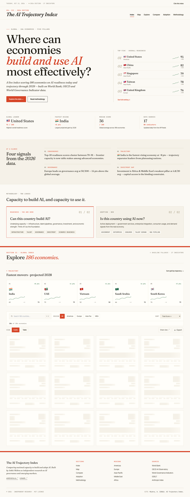
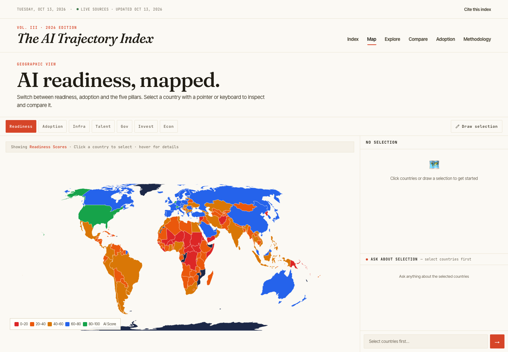
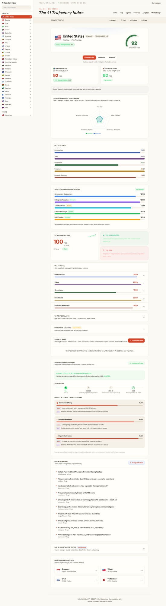

# AI Trajectory Index

**Live:** [ai-trajectory-index.vercel.app](https://ai-trajectory-index.vercel.app)

An interactive index scoring **186 economies** on current AI readiness and 3–5 year trajectory, built for investors, policymakers, and researchers comparing national capacity to build and adopt AI.

---

## Key Findings (live scores, 17 Oct 2026)

These come from the live scoring pipeline (`/api/scores`), not the static baseline, and will move as sources update. In this run, 185 of 186 economies scored on live World Bank data (Taiwan is not covered by the World Bank) and 75.5% of expected live indicators were observed.

| Finding | Detail |
|---------|--------|
| 🇩🇰 **Denmark leads overall** | 87/100, ahead of the Netherlands (86), the United States (85), Germany (84) and Singapore (84) |
| 🇸🇳 **Senegal has the strongest trajectory** | Trajectory +7: current 40 → projected 51 by 2028 |
| 🇵🇱 **Poland is the fastest-rising advanced economy** | 72 → 81 projected by 2028 (trajectory +6), the largest gain in the top 40 |
| 🇧🇾 **Belarus has the largest governance gap** | Non-governance pillars average 11.5/20 against governance at 4/20, a 7.5-point gap |
| 🌍 **Middle East & Africa face an infrastructure constraint** | Median infrastructure 7/20 against a global median of 13 |
| 🇪🇺 **Europe leads on governance** | Average governance 13.2/20 against 10.3/20 investment: policy ahead of capital |

---------|--------|
| 🇺🇸 **US leads overall** | 91/100: highest score across all 186 economies |
| 🇮🇳 **India has the strongest trajectory** | Current score 65 → projected 73 by 2028 (trajectory +8) |
| 🇦🇪 **UAE fastest-rising advanced economy** | 73 → 79 projected by 2028 (trajectory +6) |
| 🇷🇺 **Russia has the largest governance gap** | Non-governance pillars average 14.0, compared with governance at 8/20, a 6.0-point gap |
| 🌍 **Africa has an infrastructure constraint** | Median infrastructure score 5.5/20 vs global median 7.0 |
| 🇪🇺 **Europe leads on governance** | EU avg 10.2/20 governance vs 9.2/20 investment: policy ahead of capital |

---

## What It Does

- Scores 186 economies across **5 pillars**: Infrastructure, Talent, Governance, Investment, Economic Readiness (each 0–20, total 0–100)
- Shows **forward trajectory**, including which countries are accelerating, stable, or facing structural headwinds, with projected 2028 scores
- Generates a **five-section country brief** per economy (Standing & Trajectory, Infrastructure & Talent, Governance & Policy, Investment & Capital, Economic Readiness & Outlook), AI-drafted via OpenRouter (free tier) with an automatic deterministic-template fallback if every model is unavailable: the brief always renders, never a bare error
- **Interactive world map** with country selection and AI-powered comparison chat
- **Country comparison tool**: side-by-side radar charts and pillar breakdowns (up to 4 countries)
- **Region deep-dives**: Americas, Europe, Asia-Pacific, Middle East, Africa with sub-regional analysis
- **Live news feeds** per country via The Guardian and Google News RSS, with AI signal analysis
- **What-If simulator**: adjust any pillar score and see rank impact
- **Policy gap analyser**: shows which pillars fall below regional average, with governance flags
- **Shareable URLs**: all filter state and pillar weights encoded in query params
- **Embeddable widget**: `<iframe src="/widget/[country]">` for any site
- **Export** to CSV or JSON (with custom weighted scores when weights are non-default)

---

## Screenshots


*186 countries scored across 5 AI readiness pillars*


*Interactive world map with country selection and AI-powered chat*


*Individual country profiles with pillar breakdown, trajectory, and live news signal*

---

## Tech Stack

| Layer | Technology |
|-------|-----------|
| Framework | Next.js 14 (App Router) + TypeScript |
| Styling | Tailwind CSS + CSS custom properties |
| Charts | Recharts (radar, bar, scatter) + react-simple-maps |
| AI Narratives | OpenRouter API (rotating free-tier models) + deterministic template fallback |
| Live News | The Guardian Open Platform, Google News RSS, and selected technology RSS feeds |
| World Data | World Bank Open Data API, IMF DataMapper, and OECD Data Explorer |
| Policy Data | OECD.AI Policy Observatory maintained dataset |
| Governance | Worldwide Governance Indicators and Oxford Insights |
| Cron | Vercel Cron (news cache warming, nightly) |
| Deployment | Vercel |

---

## Getting Started

### Prerequisites

- Node.js 20 or later
- An OpenRouter API key is optional. The deterministic country-brief fallback works without one.

### Installation

```bash
# Clone the repo
git clone https://github.com/ankitmishra01/ai-trajectory-index.git
cd ai-trajectory-index

# Install dependencies
npm install

# Set up environment variables
cp .env.example .env.local
# Optionally add OPENROUTER_API_KEY for AI-drafted briefs and map chat

# Run locally
npm run dev
```

Open [http://localhost:3000](http://localhost:3000).

### Environment Variables

| Variable | Required | Description |
|----------|----------|-------------|
| `OPENROUTER_API_KEY` | No | Enables AI-drafted country briefs + map chat. Without it, briefs are served from the deterministic template (still complete, just not AI-drafted) |
| `NEXT_PUBLIC_SITE_URL` | No | Canonical URL for OG meta tags |
| `CRON_SECRET` | No | Protects `/api/news-cron` from unauthorised calls |
| `GUARDIAN_API_KEY` | No | Raises Guardian Open Platform limits. Without it, the client uses Guardian's public test key |

### Deployment

One-click Vercel deployment:

1. Fork this repo
2. Import to [Vercel](https://vercel.com)
3. (Optional) Add `OPENROUTER_API_KEY` for AI-drafted country briefs: omit it and briefs are served from the built-in template instead
4. Deploy: public World Bank, IMF, OECD, and Anthropic data fetch automatically; no paid data service is required

---

## Methodology

The index has two separate lenses:

1. **Readiness** measures an economy's capacity to build, govern, finance, and deploy AI. It is the primary 0–100 index.
2. **Adoption** measures observed AI use across government, business, consumers, labour demand, and the research pipeline. It is not included in the Readiness total.

The deployed methodology is version 3. The implementation is in [`lib/scoring.ts`](lib/scoring.ts), the source clients are in [`lib/worldbank.ts`](lib/worldbank.ts), [`lib/imf.ts`](lib/imf.ts), [`lib/oecd.ts`](lib/oecd.ts), and [`lib/anthropic-index.ts`](lib/anthropic-index.ts), and the public explanation is available on the [Methodology page](https://ai-trajectory-index.vercel.app/methodology).

### Readiness score

Each of the five pillars contributes 0–20 points. The pillar scores are added without further weighting:

```text
Readiness = Infrastructure + Talent + Governance + Investment + Economic Readiness
          = 0–100
```

Indicator values are converted to points using documented threshold bands. Each pillar is rounded to the nearest whole point and clamped to 0–20. The total is clamped to 0–100.

| Pillar | Point allocation | What the static component represents |
|---|---|---|
| **Infrastructure** | Fixed broadband per 100 (6), internet users (3), mobile subscriptions per 100 (3), electricity access (3), static quality component (5) | Server density, cloud availability, grid reliability, and infrastructure quality not consistently covered by the live series |
| **Talent** | Tertiary enrolment (6), labour productivity at constant 2017 PPP dollars per worker (6), talent-quality component (8) | Researcher density, education quality, ICT skills, and brain-drain conditions |
| **Governance** | Rule of Law WGI (5), Government Effectiveness WGI (4), Regulatory Quality WGI (3), national AI strategy (3), strategy recency (up to 2), AI regulation (1), institutional component (2) | Institutional and implementation capacity not captured by the three WGI series |
| **Investment** | R&D expenditure as a share of GDP (6), FDI net inflows as a share of GDP (5), capital-ecosystem component (9) | Venture activity, startup density, deal flow, and related capital-market depth |
| **Economic Readiness** | GDP per capita at constant PPP (6), private credit (3), trade openness (3), services share (3), market-capacity component (5) | Economic complexity, digital-market capacity, and business conditions |

#### Indicator thresholds

The scoring bands below are the thresholds used by the code. Values exactly on a boundary remain in the lower band because the implementation uses strict `>` comparisons unless noted.

| Indicator | Point bands |
|---|---|
| Fixed broadband per 100 | `>35: 6`; `>20: 4.5`; `>8: 3`; `>2: 1.5`; otherwise `0.5` |
| Internet users, % | `>85: 3`; `>65: 2.2`; `>40: 1.5`; `>15: 0.8`; otherwise `0.3` |
| Mobile subscriptions per 100 | `>120: 3`; `>80: 2.2`; `>40: 1.5`; otherwise `0.5` |
| Electricity access, % | `>97: 3`; `>80: 2`; `>50: 1`; otherwise `0.3` |
| Tertiary enrolment, % | `>70: 6`; `>50: 4.5`; `>30: 3`; `>15: 1.8`; otherwise `0.8` |
| Labour productivity, constant 2017 PPP dollars | `>85,000: 6`; `>65,000: 4.5`; `>40,000: 3`; `>18,000: 1.5`; otherwise `0.75` |
| R&D expenditure, % of GDP | `>3.5: 6`; `>2: 4.5`; `>1: 3`; `>0.3: 1.5`; otherwise `0.5` |
| FDI net inflows, % of GDP | Capped at 20, then `>10: 5`; `>4: 4`; `>1.5: 3`; `>0: 2`; otherwise `0.5` |
| GDP per capita, constant 2017 PPP dollars | `>55,000: 6`; `>30,000: 4.5`; `>12,000: 3`; `>4,000: 1.5`; otherwise `0.5` |
| Private credit, % of GDP | `>150: 3`; `>80: 2.2`; `>40: 1.5`; `>15: 0.8`; otherwise `0.3` |
| Trade openness, % of GDP | Capped at 200, then `>120: 3`; `>70: 2.2`; `>40: 1.5`; `>20: 0.8`; otherwise `0.3` |
| Services value added, % of GDP | `>75: 3`; `>60: 2.2`; `>45: 1.5`; `>30: 0.8`; otherwise `0.3` |

WGI estimates are clamped to `-2.5..+2.5` and converted continuously rather than placed in bands:

```text
WGI points = ((clamp(estimate, -2.5, 2.5) + 2.5) / 5) × allocated points
```

National AI strategies receive 3 points. Strategies dated 2022 or later receive a 2-point recency bonus; strategies dated 2019–2021 receive 1 point. An AI regulation flag contributes 1 point.

### Live enrichment and source precedence

The static baseline ensures coverage for all 186 economies. Live and external data replace defined portions of that baseline when available:

- World Bank values are the main quantitative input across all five pillars.
- OECD researcher density can replace 2 of the Talent baseline's 8 points.
- WIPO Global Innovation Index data can replace 1 additional Talent baseline point.
- Oxford Insights can replace the 2-point Governance institutional component.
- OECD R&D expenditure takes precedence over the World Bank R&D value when available.
- IMF government expenditure can replace 3 of the Investment baseline's 9 points.
- IMF government debt above 100% of GDP reduces the Economic Readiness market-capacity component by 1 point.
- Missing indicators receive the proportional share of the country's static pillar score. If a country has no usable live values for a pillar, the complete static pillar score is retained.

| Supplemental input | Point rule |
|---|---|
| OECD researchers per 1,000 employed | `>10: 2`; `>6: 1.5`; `>3: 1`; otherwise `0.5` |
| WIPO GII score | `>55: 1`; `>40: 0.7`; `>25: 0.4`; otherwise `0.2` |
| Oxford Insights score | `>=65: 2`; `>=45: 1.5`; `>=30: 1`; otherwise `0.5` |
| IMF government expenditure, % of GDP | `>=45: 3`; `>=35: 2`; `>=25: 1`; otherwise `0.5` |
| IMF government debt, % of GDP | Above 100 subtracts 1 point from the 5-point market-capacity allocation |

The API calculates every source independently with `Promise.allSettled`. A failed IMF, OECD, or Anthropic request does not prevent World Bank scoring or the static fallback. In `/api/scores`, `using_live_data` reports whether any World Bank indicator loaded; `sources.*` is true only when that source contributed data to at least one country; `coverage` reports the share of expected live indicators observed and any failed World Bank indicators; and each country includes `data_source`, `wb_data_year`, source-availability flags, and the raw World Bank values used in scoring.

### Score provenance and coverage

Every country returned by `/api/scores` includes two required research fields:

- `provenance`: five pillar arrays listing each input value, observation year, source organization and URL, points earned, points available, source status, and any missing-data substitution.
- `coverage`: source availability summarized as live, enriched, policy, and fallback counts, the oldest and newest live observation years, the share of the 100-point allocation dependent on fallbacks, and a `High`, `Medium`, or `Limited` label.

Coverage is not statistical confidence and does not measure a country's performance or data quality. It reports how much of the current score is supported by available source inputs.

| Coverage label | Rule |
|---|---|
| **High** | At least 75% of expected inputs are live or enriched, and fallback allocation is at most 30% |
| **Medium** | At least 50% of expected inputs are live or enriched, and fallback allocation is at most 55% |
| **Limited** | All other source-availability profiles |

The descriptive source registry lives in [`lib/methodology.ts`](lib/methodology.ts). The scorer remains the formula authority and records provenance at the same branches where it awards points. The Methodology page and the downloadable [`/api/methodology.csv`](https://ai-trajectory-index.vercel.app/api/methodology.csv) both use the shared registry, so component labels, official URLs, point budgets, and source roles stay aligned.

The homepage renders all 186 static baseline rankings immediately. It then refreshes from `/api/scores` in the background without clearing filters, comparison state, watchlists, or the current view. If the refresh fails, the baseline ranking remains fully usable and exposes a retry control.

### World Bank indicator registry

The API requests the two most recent non-empty observations (`mrnev=2`) for 17 indicators, reading every page of the response. The latest value supports Readiness and the prior value supports trend calculations where applicable.

| Code | Indicator | Use |
|---|---|---|
| `IT.NET.USER.ZS` | Individuals using the internet | Infrastructure |
| `IT.CEL.SETS.P2` | Mobile subscriptions per 100 people | Infrastructure |
| `IT.NET.BBND.P2` | Fixed broadband subscriptions per 100 people | Infrastructure and trajectory |
| `EG.ELC.ACCS.ZS` | Access to electricity | Infrastructure |
| `SE.TER.ENRR` | Gross tertiary enrolment | Talent |
| `SL.GDP.PCAP.EM.KD` | GDP per person employed, constant 2017 PPP | Talent and trajectory |
| `GB.XPD.RSDV.GD.ZS` | R&D expenditure as a share of GDP | Investment and trajectory |
| `GOV_WGI_GE.EST` | Government Effectiveness estimate | Governance |
| `GOV_WGI_RL.EST` | Rule of Law estimate | Governance |
| `GOV_WGI_RQ.EST` | Regulatory Quality estimate | Governance |
| `BX.KLT.DINV.WD.GD.ZS` | FDI net inflows as a share of GDP | Investment |
| `NY.GDP.PCAP.PP.KD` | GDP per capita at constant 2017 PPP | Economic Readiness |
| `NY.GDP.PCAP.CD` | GDP per capita in current US dollars | Trajectory growth only |
| `FS.AST.PRVT.GD.ZS` | Domestic credit to the private sector | Economic Readiness |
| `NE.TRD.GNFS.ZS` | Trade in goods and services | Economic Readiness |
| `NV.SRV.TOTL.ZS` | Services value added | Economic Readiness |
| `TX.VAL.TECH.MF.ZS` | High-technology exports | Trajectory |

### Trajectory and projection

Trajectory is a separate `-10..+10` score. Missing trend inputs use the corresponding share of the static trajectory baseline.

| Component | Weight | Maximum contribution |
|---|---:|---:|
| GDP per capita growth | 20% | ±2.0 |
| R&D expenditure trend | 15% | ±1.5 |
| Labour-productivity trend | 15% | ±1.5 |
| High-technology exports trend | 20% | ±2.0 |
| Fixed-broadband growth | 10% | ±1.0 |
| National AI strategy recency | 10% | ±1.0 |
| Static trajectory baseline | 10% | ±1.0 |

Anthropic Economic Index usage intensity adds a supplemental `+0.5` for scores of 60 or higher and `-0.5` for scores below 20. The final result is rounded and clamped to `-10..+10`.

| Trend input | Contribution bands |
|---|---|
| GDP per capita growth | `>6%: +2`; `>3%: +1.2`; `>0%: +0.4`; `>-3%: -0.4`; otherwise `-2` |
| R&D share change | `>0.3 pp: +1.5`; `>0.1: +0.8`; `>-0.1: 0`; `>-0.3: -0.5`; otherwise `-1.5` |
| Labour-productivity growth | `>3%: +1.5`; `>1%: +0.8`; `>-1%: -0.3`; otherwise `-1.5` |
| High-technology export-share change | `>3 pp: +2`; `>0.5: +1`; `>-0.5: 0`; `>-3: -0.8`; otherwise `-2` |
| Fixed-broadband change per 100 people | `>2: +1`; `>0.5: +0.5`; `>-0.5: 0`; otherwise `-0.5` |
| National AI strategy | Dated 2022 or later: `+1`; dated 2019–2021: `+0.5`; older: `0`; no strategy: `-0.5` |

| Score | Label |
|---:|---|
| `6..10` | Strong Positive |
| `2..5` | Positive |
| `-1..1` | Neutral |
| `-5..-2` | Negative |
| `-10..-6` | Strong Negative |

The forward estimate is a directional scenario, not a forecast:

```text
Projected 2028 score = clamp(Readiness + Trajectory × 1.5, 0, 100)
```

### Readiness tiers

| Score | Tier | Interpretation |
|---:|---|---|
| 80–100 | Leading | Frontier readiness |
| 60–79 | Advanced | Strong foundations |
| 40–59 | Developing | Core building blocks are present |
| 0–39 | Nascent | Early-stage readiness |

### Adoption lens

The Adoption lens is intentionally separate from Readiness. Each of its five dimensions contributes 0–20 points: Government Deployment, Enterprise Adoption, Talent Demand, Consumer Usage, and R&D Pipeline. The values and evidence are maintained in [`data/adoption.json`](data/adoption.json); they are not calculated by `lib/scoring.ts` and do not change the primary Readiness ranking.

```text
Adoption total = Government + Enterprise + Talent Demand + Consumer + R&D Pipeline
Adoption gap   = Adoption total - Readiness total
```

| Adoption total | Tier |
|---:|---|
| 70–100 | High Adoption |
| 50–69 | Growing Adoption |
| 30–49 | Early Adoption |
| 0–29 | Nascent Adoption |

### Methodological principles and limitations

- **No deliberate double-counting:** R&D expenditure belongs to Investment, GDP per capita at PPP belongs to Economic Readiness, and connectivity belongs to Infrastructure.
- **Continuous institutional scoring:** WGI estimates retain more information than binary policy flags.
- **Purchasing-power adjustment:** Economic Readiness uses constant 2017 PPP dollars. Current-dollar GDP is used only for its change rate in trajectory.
- **Quality as well as access:** Fixed broadband receives more weight than internet penetration because access rates are saturated in many advanced economies.
- **Transparent fallbacks:** Static components fill gaps in internationally comparable data, especially for smaller economies. This improves coverage but introduces expert-judgment risk.
- **Uneven data years:** World Bank and other official indicators are released on different schedules and often lag current conditions by one or more years. `wb_data_year` exposes the newest World Bank year used for each country.
- **Threshold sensitivity:** Scores near a band boundary may move by more than the underlying indicator change suggests.
- **Projection limits:** The 2028 value extends the trajectory score mechanically. It is not a probability, investment recommendation, or prediction of policy outcomes.
- **Adoption evidence:** Adoption is a curated comparative lens rather than a live statistical model. It should be interpreted alongside Readiness and the cited country evidence.

---

## Data Sources

### Direct scoring inputs

| Source | Role | Refresh behavior |
|---|---|---|
| [World Bank Open Data](https://data.worldbank.org/) and [Indicators API documentation](https://datahelpdesk.worldbank.org/knowledgebase/articles/889392-about-the-indicators-api-documentation) | Seventeen live indicators across all five pillars and trajectory | Fetched with a 24-hour Next.js cache |
| [Worldwide Governance Indicators](https://www.worldbank.org/en/publication/worldwide-governance-indicators) | Rule of Law, Government Effectiveness, and Regulatory Quality | Retrieved through the World Bank API |
| [IMF DataMapper](https://www.imf.org/external/datamapper/) | Government expenditure and gross debt | Fetched with a 24-hour cache |
| [OECD Data Explorer](https://data-explorer.oecd.org/) | R&D expenditure and researchers per 1,000 employed | Fetched from the OECD SDMX API with a 24-hour cache |
| [OECD.AI Policy Observatory](https://oecd.ai/en/) | National AI strategy dates, regulation flags, and OECD membership in the maintained policy dataset | Updated in `data/ai-policies.json` |
| [Anthropic Economic Index dataset](https://huggingface.co/datasets/Anthropic/EconomicIndex) | Country usage-intensity modifier for trajectory | Precomputed by `scripts/build-anthropic-usage.mjs` into `data/anthropic-usage.json` (Claude.ai conversations per million working-age people, percentile rank); rebuild when a new release lands |
| [Oxford Insights Government AI Readiness Index](https://oxfordinsights.com/ai-readiness/government-ai-readiness-index-2025/) | Governance institutional enrichment | Maintained in `data/external-indices.json` |
| [WIPO Global Innovation Index](https://www.wipo.int/en/web/global-innovation-index) | Talent-quality enrichment | Maintained in `data/external-indices.json` |

### Calibration and reference sources

The maintained external-indices dataset also records values from the sources below for cross-checking and research context. They are not currently passed into the production scoring functions unless a direct use is described above.

| Source | Current role |
|---|---|
| [Stanford HAI AI Index](https://hai.stanford.edu/ai-index/2025-ai-index-report) | Research-output and policy context |
| [Tortoise Global AI Index](https://www.tortoisemedia.com/data/global-ai) | Composite-index comparison and calibration |
| [ITU ICT Development Index](https://www.itu.int/itu-d/reports/statistics/idi2024/) | Infrastructure cross-check |
| [WEF Future of Jobs Report 2025](https://www.weforum.org/publications/the-future-of-jobs-report-2025/) | Workforce and employer-adoption context |

### Product and narrative services

| Source | Role | Refresh behavior |
|---|---|---|
| [The Guardian Open Platform](https://open-platform.theguardian.com/) | Country and global AI news; uses the public test key unless `GUARDIAN_API_KEY` is configured | On demand, with a one-hour country cache |
| [Google News](https://news.google.com/) and publisher RSS feeds | Country-news coverage and the global AI ticker | On demand; global results use a 30-minute cache |
| [OpenRouter](https://openrouter.ai/) | Optional AI-drafted briefs, map chat, and news-signal analysis | Deterministic country briefs remain available without a key |

The index does not treat all publications listed above as live scoring feeds. The direct-scoring and calibration sections state the implemented role of each source.

---

## Project Structure

```
/app
  page.tsx                 : Main country index
  /map/page.tsx            : Interactive world map + AI chat
  /adoption/page.tsx       : Separate AI adoption lens
  /africa|americas|europe|asia-pacific|middle-east/page.tsx: Region deep-dives
  /country/[slug]/page.tsx : Individual country profiles
  /compare/[a]/[b]/page.tsx: Shareable comparison route, expandable to 4 countries
  /explore/page.tsx        : Scatter plot explorer
  /methodology/page.tsx    : Full scoring methodology
  /widget/[slug]/page.tsx  : Compact, iframe-safe country widget
  /api/
    scores/route.ts        : Multi-source scoring endpoint (24h cache)
    methodology.csv/       : Downloadable methodology data dictionary
    narrative/[country]/   : Five-section country brief: AI-drafted via OpenRouter, template fallback (7d cache)
    news/[slug]/           : Guardian and Google News RSS feed (1h cache)
    news-signal/[slug]/    : AI signal analysis (24h cache)
    news-cron/route.ts     : Vercel Cron: warms top-50 news cache nightly

/components
  CountryCard.tsx          : Card with mini dimension bars + trajectory badge
  CountryPageClient.tsx    : Country detail page (client component)
  CoverageBadge.tsx        : Coverage label, source counts, year range, and fallback share
  PillarProvenance.tsx     : Accessible per-pillar score-input table
  CountryNewsFeed.tsx      : Live news + AI signal panel
  ComparisonPanel.tsx      : Radar chart comparison (up to 4 countries)
  FilterBar.tsx            : Search + consolidated filter + sort (slide-out panel)
  FastestMovers.tsx        : Top 5 trajectory countries (compact tiles)
  KeyInsights.tsx          : Auto-generated insights from live data
  GovernanceGapPanel.tsx   : Top 10 countries where capabilities outpace governance
  PolicyGapAnalyser.tsx    : Pillar gaps vs regional average + governance flags
  WhatIfSimulator.tsx      : Interactive pillar adjustment + rank impact
  RegionDeepDive.tsx       : Shared region deep-dive layout (bar charts)
  WorldMap.tsx             : react-simple-maps SVG world map
  SiteHeader.tsx           : Shared navigation, data status, and citation controls
  ScoreGauge.tsx           : SVG semicircle gauge
  RankingsTable.tsx        : Sortable tabular view
  ExportButton.tsx         : CSV/JSON export (includes weighted score column)
  PillarWeights.tsx        : Custom pillar weight sliders with URL encoding

/lib
  worldbank.ts             : WB API client (17 indicators, parallel fetch, 24h cache)
  imf.ts                   : IMF DataMapper client (expenditure and debt)
  oecd.ts                  : OECD SDMX client (R&D and researchers)
  anthropic-index.ts       : Anthropic Economic Index public-dataset client
  scoring.ts               : Score calculation engine (5 pillars + trajectory)
  methodology.ts           : Shared descriptive indicator and source registry
  provenance.ts            : Static provenance and coverage calculation
  homeRefresh.ts           : Baseline-first homepage refresh state
  adoption.ts              : Adoption types, labels, and readiness enrichment
  openrouter.ts            : OpenRouter client (AI-drafted briefs + news signal analysis)
  narrativeTemplate.ts     : Deterministic 5-section brief generator: fact pack + template + fallback
  gdelt.ts                 : Multi-source Guardian and RSS news client (legacy filename)
  slugToIso.ts             : 186 slug → ISO2 mappings
  regionConfigs.ts         : Region deep-dive configuration
  types.ts                 : Country, ScoredCountry, provenance, coverage, and API response types

/data
  countries.json           : 186 countries: static baseline scores + evidence
  adoption.json            : Separate five-dimension adoption scorecard
  ai-policies.json         : Policy metadata keyed by slug
  external-indices.json    : Maintained external-index enrichment and calibration values
  narratives/.gitkeep      : Cached narratives directory (files are gitignored)
```

---

## Contributing

Issues and pull requests are welcome. If you spot a data error, have a methodology suggestion, or want to add a feature, please open an issue first.

Areas where contributions are especially welcome:
- Additional governance data sources (Freedom House, V-Dem)
- Improved trajectory modelling (patent filings, AI publication growth)
- Better data for smaller economies where World Bank coverage is thin
- Translation and localisation

---

## Citing This Index

If you reference this tool in research or journalism:

> Mishra, A. (2026). *AI Trajectory Index: Scoring 186 Economies on AI Readiness and 3–5 Year Trajectory*. Retrieved from https://ai-trajectory-index.vercel.app

---

## About

Built by **[Ankit Mishra](https://ankitmishra.ca)** as an independent research tool at the intersection of AI governance, emerging markets, and technology policy.

- Commercial Portfolio Director at a leading African climatetech venture fund
- Member, [Schwartz Reisman Institute AI & Trust Working Group](https://srinstitute.utoronto.ca), University of Toronto
- Forbes contributor: [50+ articles](https://www.forbes.com/sites/ankitmishra/), 200,000+ readers

[LinkedIn](https://www.linkedin.com/in/ankitmishra3/) · [ankitmishra.ca](https://ankitmishra.ca)

---

## License

[MIT License](LICENSE): free to use, modify, and distribute with attribution.
